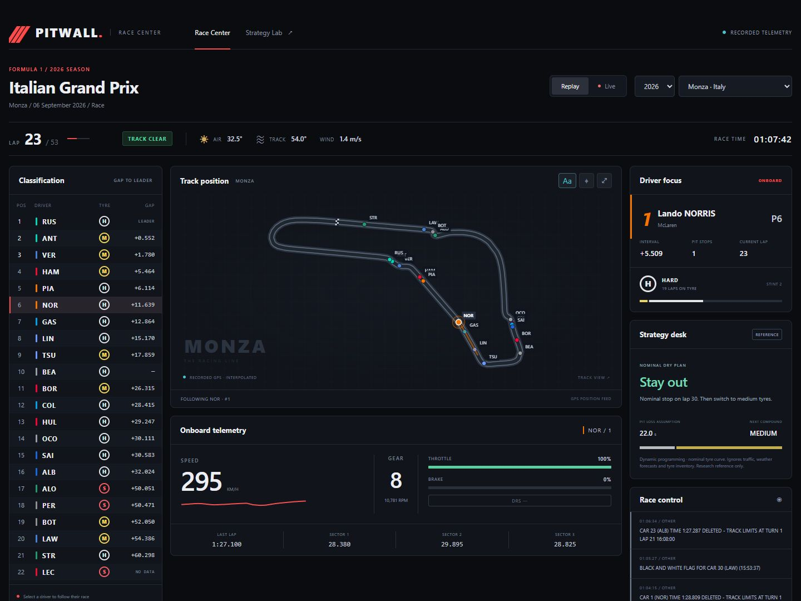
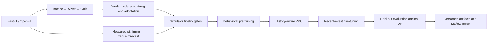

# Pitwall AI

Watch a race unfold, explore pit strategy, and reproduce the model training behind it.
Pitwall combines an animated Formula 1 race center with a historical race simulator
and an end-to-end machine-learning pipeline.

[](https://github.com/whk-irl/F1_Strategy/actions/workflows/ci.yml)
[](pyproject.toml)

**[Open the live demo](https://f1strategy-forza.streamlit.app/)** ·
[Training results](docs/model-cards/2026-10-16-pit-time-retraining.md) ·
[Temporal IQL design](docs/decisions/0006-temporal-iql.md) ·
[Race Center guide](docs/guides/race-center.md)



## Explore the race

**Race Center** opens with a recorded race. Cars follow actual OpenF1 position
samples around a recorded circuit trace, with smooth interpolation between samples.

- **Track position:** follow any driver, toggle labels, and switch between full-circuit
  and selected-car views.
- **Race panels:** classification and gaps, tyre compounds and stint history, speed,
  gear, throttle, brake, completed-lap sectors, weather, and race-control messages.
- **Strategy command:** compare boxing now, the model window, and extending the stint;
  see measured pit loss, projected rejoin range, and named undercut/overcut rivals with
  their tyre compound, age, gap, and recent-stop state.
- **Playback:** pause, seek, restart, and replay at 1×–60×. Timing follows the replay cursor.
- **Strategy Lab:** compare the baked model experiments and read the latest published
  pretraining and fine-tuning results.

Historical replay is free, with OpenF1 coverage from 2023 onwards. The first load of
a race downloads and caches its GPS and telemetry, which can take a minute or more.
Positions are approximate; missing or stale data stays unavailable.

The **Live** tab refreshes every 15 seconds with a 20-second playback buffer. A local
FastF1 public timing collector supplies an experimental free route for timing, gaps,
tyres, weather and race control. GPS and full car telemetry are unavailable in that
mode. The OpenF1 live route requires a subscription; historical replay remains free.
See the [US GP live-test guide](docs/guides/live-race-test.md).

The October 24 US GP update imports **1,799 FP1/FP2/FP3/qualifying laps**, keeps the
published starting grid distinct from qualifying order, and feeds practice estimates
into the 56-lap race reference plan. Run `./scripts/start_usgp_live.ps1` locally before
the race. Public-stream connection is verified; fresh race delivery must be checked
during the session. This updates weekend calibration, without retraining the IQL policy.

## Latest training result

The October 16 run used **120,935 lap records across 109 events**, including 17
completed 2026 races acquired through OpenF1. A separate pit-time model fitted
1,815 routine measured stops from earlier races. The policy lifecycle covers
supporting-model pretraining and adaptation, simulator validation, behavioral cloning,
four-frame PPO pretraining, and recent-event fine-tuning.

| Held-out policy | Mean position | Mean race time (s) | Mean pit stops |
|---|---:|---:|---:|
| Source PPO | 8.575 | 5983.33 | 1.60 |
| Fine-tuned PPO | 8.550 | 5986.12 | 1.82 |
| Dynamic-programming benchmark | **8.400** | **5972.31** | 1.00 |

**The new PPO candidate is not promoted.** It trailed dynamic programming by
13.73 seconds on the held-out event-weighted comparison. Evaluation used 40 paired
episodes across three eligible events and one training seed. Both simulator gates
passed the required Spearman rho ≥ 0.7 (0.828 and 0.821). The independent measured
pit-time model is available to Race Center regardless of policy promotion.

The next research candidate is now implemented as **temporal implicit Q-learning**:
a causal Transformer over 12 laps, double offline Q estimates, expectile value
learning, advantage-weighted behavior fitting, and a two-compound rule shield. The
new acquisition profile adds verified 2021 races to the 2022–2026 corpus and is
configured for multi-seed GPU training on SLURM. A one-epoch local smoke run completed
the offline-policy path; its score is an integration check rather than a model result.

Read the [model card](docs/model-cards/2026-10-16-pit-time-retraining.md) for splits, uncertainty,
supporting-model metrics and limitations, and the [algorithm decision](docs/decisions/0005-staged-policy-training.md)
for the research behind the method. The race-center strategy desk is a labelled
nominal dry-race DP reference, separate from the calibrated evaluation benchmark.

## Run locally

Use Python 3.11 and [uv](https://docs.astral.sh/uv/).

```bash
git clone https://github.com/whk-irl/F1_Strategy.git
cd F1_Strategy
uv sync --python 3.11 --extra dev
uv run streamlit run services/frontend/app.py
```

Open `http://localhost:8501`. Race Center fetches historical data on first use.
Strategy Lab includes baked models and 2022–2025 lap data, so training is optional
for exploring those experiments. The published model card and chart also ship with
the app; full checkpoints and MLflow runs remain local generated artifacts.

For live access, set `OPENF1_TOKEN` on the server, or `OPENF1_USERNAME` and
`OPENF1_PASSWORD` for automatic token renewal. `.env.example` lists optional settings.
Keep credentials in environment variables or the hosting provider's secret store.

## Retrain end to end

```bash
uv run python -m services.ingestion.acquire --years 2026 --provider auto
uv run python scripts/acquire_pit_history.py --years 2023,2024,2025,2026
uv run python -m ml.pipelines.pit_time
uv run python -m ml.pipelines.train --config configs/training.pit-time.json

# Larger offline-RL candidate (local or SLURM)
uv run python -m services.ingestion.acquire --years 2021 --provider fastf1
uv run python -m ml.pipelines.train_iql --config configs/training.iql-hpc.json --resume
# sbatch infra/slurm/train_temporal_iql.sbatch
```



Acquisition is resumable and records source checksums. Features are rebuilt causally;
event splits are chronological, with validation for checkpoint selection and separate
final test events. Policy learning starts only after both simulator gates pass.

The local profile budgets 200,000 PPO source steps and 100,000 fine-tuning steps.
It writes checkpoints, normalization statistics, split membership, metrics and
provenance under `runs/`. Use `--resume` to verify completed stages of an unchanged
run. Choose a new `output_dir` after changing source, data or configuration; the
saved October 16 run is tied to the source fingerprint in its report.

See the [training guide](docs/guides/staged-training.md) for configuration, artifacts
and inference. The 96-input staged candidate has a dedicated loader and does not
overwrite the legacy 21-input models.

## Validation and scope

```bash
uv run ruff check .
uv run ruff format --check .
uv run mypy services/ ml/
uv run pytest
```

The US GP live-test update passes **228 tests with 86.95% configured coverage**, plus Ruff
and mypy checks. Replay controls and desktop/mobile layouts were checked in the
browser. Authenticated active-session timing still requires verification during a race.

This is an independent research project. Opponents follow recorded trajectories;
they do not react to the policy. The trained candidate covers dry races without red
flags and does not model tyre inventory. Results do not establish real-race superiority.

The repository also contains cloud-agnostic storage, serving and infrastructure
scaffolding. [Deployment instructions](docs/guides/deployment.md) describe the existing
Streamlit Community Cloud app. See [architecture](docs/architecture.md) and
[scope](docs/scope.md) for the wider project.

## License

The project declares the [MIT license](pyproject.toml). Race data is supplied by [FastF1](https://docs.fastf1.dev/) and
[OpenF1](https://openf1.org/). This project is unofficial and is not affiliated with
Formula 1, the FIA, or any team.
