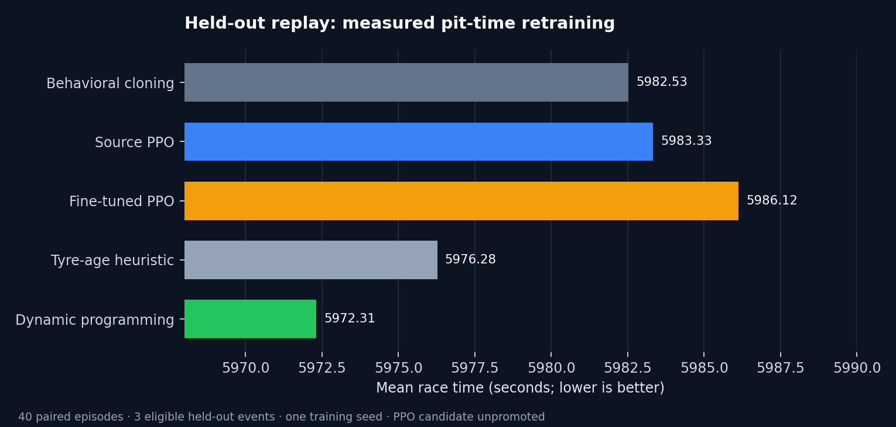

# October 16, 2026 measured pit timing and policy retraining

The race simulator and Race Center now use a pit-time model fitted to recorded
OpenF1 stops. The live panel predicts **pit-lane duration** and shows a separate
estimate of **net race-time loss**. Those quantities differ: driving the normal
track segment also takes time. The rejoin warning compares estimated loss with
current same-lap timing gaps; it does not model traffic or rivals' future actions.

## Data and fitting

Historical pit and lap records were cached from 81 completed OpenF1 races in
2023–2026. The fit uses 1,815 routine stops from 2023 and 2025 plus the first ten
acquired 2026 rounds. Of those, 1,127 have a usable net-loss target from the
driver's observed in-lap and out-lap compared with nearby clean laps. Stops with
missing lane time, lane duration outside 12–45 seconds, or a disrupted adjacent-lap
delta were excluded from the routine fit. Longer recorded stops remain visible in
the UI as actual events.

The model estimates a circuit median and 10th–90th percentile range, shrunk toward
the global distribution for sparse venues. During a race, earlier completed routine
stops adjust the circuit estimate. A replay never reads stops after its cursor.
The artifact is [published with the app](../../models_baked/pit_time.json).

| Unseen events | Lane rows | Lane MAE, historical model | Lane MAE with prior same-race stops | Global median MAE | Nominal net-loss MAE |
|---|---:|---:|---:|---:|---:|
| 2024 simulator-gate season | 765 | 1.532 s | 1.376 s | 2.924 s | 2.672 s on 605 clean stops |
| 2026 rounds 11–13 | 97 | 1.618 s | 1.040 s | 3.502 s | 2.417 s on 74 clean stops |
| 2026 rounds 14–17 | 153 | 5.239 s | 2.500 s | 5.171 s | 3.666 s on 65 clean stops |

The circuit-only lane estimate did not beat the global median on the final 2026
events. The within-race update reduced error after prior stops were observed.
The net-loss score applies only to stops passing the clean-lap filter, so it does
not measure accuracy for safety cars, red flags, traffic or repairs. Reported
percentile ranges are empirical historical ranges rather than calibrated coverage
guarantees. The 0.6 net-loss adjustment under a neutralisation is still a heuristic.

## Acquisition correction

OpenF1 pit records commonly identify the **out-lap** number. The previous importer
marked that lap as a pit decision. The corrected importer checks `is_pit_out_lap`
and marks the preceding in-lap. All 17 acquired 2026 gold sessions were rebuilt
under feature version `causal-v3`; training demonstrations now use aligned actions.

## Full policy run

The pipeline uses [this configuration](../../configs/training.pit-time.json),
records the pit-model checksum, and runs tire and safety-car pretraining, sequence
adaptation, both simulator gates, behavioral cloning, PPO pretraining, fine-tuning,
and held-out evaluation. Its fingerprint is
`8435c7c4a56eac3556a967a712060170cde1d085d59a129f17389e25e5aefb5a`.
Both simulator gates passed: legacy replay Spearman rho **0.828**, and the actual
policy environment **0.821**. Behavioral cloning used 21,337 demonstrations,
including 699 pit decisions. PPO ran 200,704 source and 100,352 adaptation steps.

| Held-out policy | Mean position | Mean race time | Mean stops | Two-compound compliance |
|---|---:|---:|---:|---:|
| Behavioral cloning | 8.525 | 5982.53 s | 1.325 | 100% |
| Source PPO | 8.575 | 5983.33 s | 1.600 | 100% |
| Fine-tuned PPO | 8.550 | 5986.12 s | 1.825 | 100% |
| Tyre-age heuristic | 8.525 | 5976.28 s | 1.000 | 100% |
| Dynamic programming | **8.400** | **5972.31 s** | 1.000 | 100% |

Fine-tuned PPO was **13.73 seconds slower** than dynamic programming on the
event-weighted comparison (event-bootstrap interval **+8.84 to +16.78 s**).
There were 40 paired episodes across three eligible held-out events and one
training seed. The interval excludes training-seed and simulator uncertainty.
The candidate **failed the promotion gate**; its checkpoints remain local and
the deployed Strategy Lab still uses its existing baked policies. The measured
pit-time artifact powers the race desk and simulator independently of that policy.

Supporting-model test scores: tire MAE **3.081 s** versus **3.199 s** for a
zero-delta baseline; safety-car average precision **0.320** versus prevalence
**0.124**. Opponents follow recorded trajectories, so these results do not
establish live-race performance. The policy covers dry races without red flags
and does not model tyre inventory.

Verification: **167 tests passed** with **89.14% configured coverage**; Ruff,
mypy and JavaScript syntax checks passed. Full checkpoints, per-episode evidence,
source checksums and MLflow records are in the ignored local run directory.
